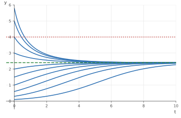
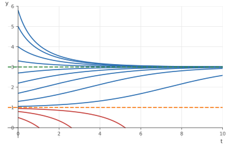

# Harvesting
Back to [Index](../Index.md) · Chapter 2.5 · [Autonomous Equations and Phase Lines](Autonomous%20Equations%20and%20Phase%20Lines.md)

## Schaefer model (effort harvesting)
$$
\frac{dy}{dt} = r\left(1 - \frac{y}{K}\right)y - Ey
$$
- Equilibria are $y_1 = 0$ and $y_2 = K\left(1 - \dfrac{E}{r}\right)$. When $E < r$, $y_2$ is stable.
- The sustainable yield is $Y = Ey_2 = KE\left(1 - \dfrac{E}{r}\right)$. It is largest at $E = r/2$, giving $Y_{\max} = rK/4$.

The harvested model is logistic with rate $r - E$ and capacity $K(1 - E/r)$. Below, $r = 1$, $K = 4$, $E = 0.4$, so solutions approach $y_2 = 2.4$ instead of $K$.

## Constant-yield harvesting
$$
\frac{dy}{dt} = r\left(1 - \frac{y}{K}\right)y - h
$$
If $h > rK/4$, there are no equilibria and the population collapses (see [saddle-node bifurcation](Bifurcations.md)).

When $h < rK/4$, the equilibria $a < b$ are the roots of $r\left(1 - \frac{y}{K}\right)y = h$. Writing $k = r(b-a)/K$ and $C = \frac{y_0 - b}{y_0 - a}$, the solution is
$$
y(t) = \frac{b - aCe^{-kt}}{1 - Ce^{-kt}}
$$
$b$ is stable and $a$ is unstable, so a population that starts below $a$ is harvested to extinction in finite time. Below, $r = 1$, $K = 4$, $h = 0.75$, so $a = 1$ and $b = 3$.

