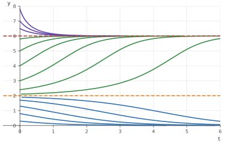

# Logistic Growth with a Threshold
Back to [Index](../Index.md) · Chapter 2.5 · [Autonomous Equations and Phase Lines](Autonomous%20Equations%20and%20Phase%20Lines.md)

This model combines [Threshold Growth](Threshold%20Growth.md) with [Logistic Growth](Logistic%20Growth.md).
$$
\frac{dy}{dt} = -r\left(1 - \frac{y}{T}\right)\left(1 - \frac{y}{K}\right)y, \qquad r > 0,\ 0 < T < K
$$
- $y = 0$ and $y = K$ are **asymptotically stable**. $y = T$ is **unstable** and acts as the threshold.
- A population that starts below $T$ dies out. One that starts above $T$ approaches the carrying capacity $K$.

The solution is implicit. Separating variables with partial fractions gives $t = \frac{1}{r}\left[F(y_0) - F(y)\right]$, where
$$
F(y) = \ln|y| - \frac{K}{K-T}\ln\left|1 - \frac{y}{T}\right| + \frac{T}{K-T}\ln\left|1 - \frac{y}{K}\right|
$$
The graph plots $t$ as a function of $y$ in each region.

## Workbook problems
- [WB1 P27 - Logistic Growth with a Threshold](../Workbook%201/WB1%20P27%20-%20Logistic%20Growth%20with%20a%20Threshold.md)
