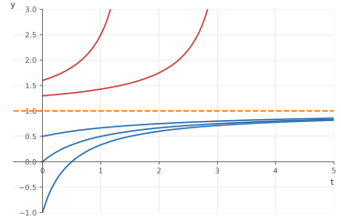
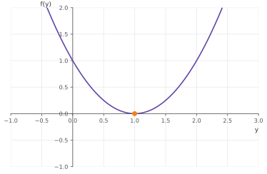

# Semistable Equilibrium
Back to [Index](../Index.md) · Chapter 2.5 · [Autonomous Equations and Phase Lines](Autonomous%20Equations%20and%20Phase%20Lines.md)

An equilibrium $y_1$ of $y' = f(y)$ is **semistable** if solutions approach it from one side and move away on the other.
- Test: $f$ has the **same sign** on both sides of $y_1$. Then $f'(y_1) = 0$, so the derivative test is inconclusive.
- On the phase line one arrow points toward $y_1$ and the other points away.
- Typical form: a repeated root, as in $f(y) = (y - 1)^2$. Semistable points appear at a saddle-node [bifurcation](Bifurcations.md).

Example $y' = (y - 1)^2$ with $y_1 = 1$. Solutions below rise toward $1$. Solutions above blow up.

Phase plot $f(y) = (y - 1)^2$. The graph touches zero without crossing.

See also: [Stable Equilibrium](Stable%20Equilibrium.md), [Unstable Equilibrium](Unstable%20Equilibrium.md)
