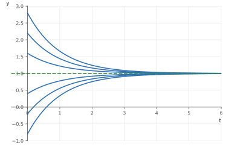
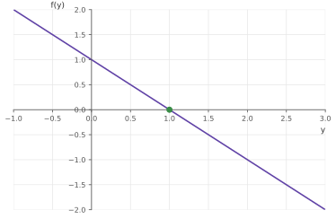

# Stable Equilibrium
Back to [Index](../Index.md) · Chapter 2.5 · [Autonomous Equations and Phase Lines](Autonomous%20Equations%20and%20Phase%20Lines.md)

An equilibrium $y_1$ of $y' = f(y)$ (so $f(y_1) = 0$) is **asymptotically stable** if every solution that starts near $y_1$ approaches $y_1$ as $t \to \infty$.
- Test: $f'(y_1) < 0$. Equivalently, $f > 0$ just below $y_1$ and $f < 0$ just above.
- On the phase line both arrows point **toward** $y_1$ (a sink).
- Example: $y = K$ in [Logistic Growth](Logistic%20Growth.md) and $y = 0$ in [Threshold Growth](Threshold%20Growth.md).

Example $y' = -(y - 1)$ with $y_1 = 1$. Every solution curve converges to the dashed line.

Phase plot $f(y) = -(y - 1)$. The graph crosses zero going **down**.

See also: [Unstable Equilibrium](Unstable%20Equilibrium.md), [Semistable Equilibrium](Semistable%20Equilibrium.md)
