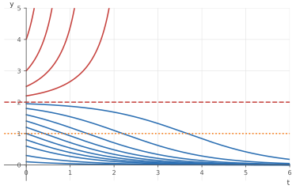

# Threshold Growth
Back to [Index](../Index.md) · Chapter 2.5 · [Autonomous Equations and Phase Lines](Autonomous%20Equations%20and%20Phase%20Lines.md)

This is the critical-threshold model. $r > 0$ is a rate constant and $T > 0$ is the threshold level.
$$
\begin{align*}
\frac{dy}{dt} &= -r\left(1 - \frac{y}{T}\right)y \\
y(t) &= \frac{y_0 T}{y_0 + (T - y_0)e^{rt}}
\end{align*}
$$
- $y = 0$ is [asymptotically stable](Stable%20Equilibrium.md) and $y = T$ is [unstable](Unstable%20Equilibrium.md).
- Solutions starting below $T$ decay to $0$. Solutions between $T/2$ and $T$ have an inflection point at $y = T/2$.
- Solutions starting above $T$ blow up in finite time at $t^* = \frac{1}{r}\ln\frac{y_0}{y_0 - T}$.

## Workbook problems
- [WB1 P25 - A Critical Threshold](../Workbook%201/WB1%20P25%20-%20A%20Critical%20Threshold.md)
- [WB1 P26 - Critical Threshold Blow-Up](../Workbook%201/WB1%20P26%20-%20Critical%20Threshold%20Blow-Up.md)

See also: [Logistic Growth](Logistic%20Growth.md), [Logistic Growth with a Threshold](Logistic%20Growth%20with%20a%20Threshold.md)
