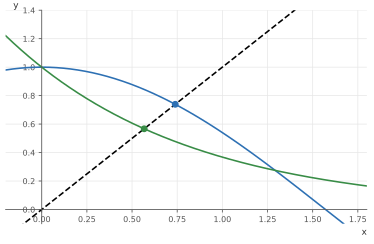

# Fixed Point Iteration
Back to [Index](../Index.md) · Lecture 7

Pick $x_0$ and repeat $x_{n+1} = g(x_n)$. If the sequence converges and $g$ is continuous, the limit is a [fixed point](Roots%20and%20Fixed%20Points.md).

Both curves cross $y = x$ once: $\cos x$ at $0.7391$ and $e^{-x}$ at $0.5671$.

## Error analysis
By the Mean Value Theorem, with $e_n = x_n - x^*$:
$$
e_{n+1} = g(x_n) - g(x^*) = g'(\eta)\,e_n, \qquad \eta \text{ between } x_n \text{ and } x^*
$$

## Convergence theorem
If $\lvert g'(x)\rvert \le G < 1$ on $[x^* - r,\, x^* + r]$, then for every $x_0$ in that interval the iteration converges to $x^*$, and
$$
\boxed{\,\lvert e_{n+1}\rvert \le G\,\lvert e_n\rvert\,}
$$
- The smaller $\lvert g'(x^*)\rvert$, the faster. Convergence is linear with rate $\lvert g'(x^*)\rvert$ ([Order of Convergence](Order%20of%20Convergence.md)).
- $g'(x^*) > 0$: one-sided approach. $g'(x^*) < 0$: the iterates alternate sides.
- $\lvert g'(x^*)\rvert > 1$: diverges. $\lvert g'(x^*)\rvert = 1$: borderline.

## Without a derivative
The condition that matters is being a **contraction**: $\lvert g(x) - g(y)\rvert \le G\,\lvert x - y\rvert$ with $G < 1$. For example $g(x) = \lvert x\rvert/2$ is not differentiable at $0$ but still converges. This is exactly the hypothesis of [Banach's Fixed Point Theorem](../../../archive/proofs/Explorations/Banach's%20Fixed%20Point%20Theorem.md), which also gives existence and uniqueness of $x^*$ and works in any complete metric space. The same theorem proves [existence and uniqueness for ODEs](../../math-212/Topics%201/Existence%20and%20Uniqueness%20Theorems.md) and explains when [gradient descent converges](../../../self-study/convex-optimization/numerical-optimization/Gradient%20Descent%20as%20a%20Fixed%20Point%20Iteration.md).

## Explorations
- [EX52 - Fixed Point Iteration for e^-x and -ln x](../Explorations%204/EX52%20-%20Fixed%20Point%20Iteration%20for%20e^-x%20and%20-ln%20x.md)

See also: [Newton's Method](Newton's%20Method.md), which is a fixed point iteration with $g'(x^*) = 0$
