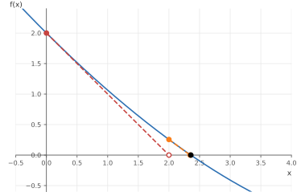

# Newton's Method
Back to [Index](../Index.md) · Lecture 7

Follow the tangent line to the axis, and repeat.

For $f(x) = 2\cosh(x/4) - x$: the tangent at $x_0 = 0$ lands on $x_1 = 2$, and the tangent there lands on $x_2 = 2.345$.

## Derivation
Truncate the Taylor series at $x_n$ and ask for $f(x_{n+1}) = 0$:
$$
0 \approx f(x_n) + f'(x_n)(x_{n+1} - x_n) \quad\Longrightarrow\quad \boxed{\,x_{n+1} = x_n - \frac{f(x_n)}{f'(x_n)}\,}
$$

## Why it is fast
It is a [fixed point iteration](Fixed%20Point%20Iteration.md) with $g(x) = x - \dfrac{f(x)}{f'(x)}$, and
$$
g'(x) = \frac{f(x)\,f''(x)}{[f'(x)]^2}
$$
At a [simple root](Roots%20and%20Fixed%20Points.md), $g'(x^*) = 0$. The linear term of the error vanishes, leaving
$$
e_{n+1} \approx \tfrac12 g''(x^*)\,e_n^2 = \frac{f''(x^*)}{2f'(x^*)}\,e_n^2
$$
**Quadratic convergence:** near the root the number of correct digits doubles each step.

## Where it fails
- **Local only.** Far from the root, a step can land anywhere.
- $f'(x_n) = 0$ or undefined. For $f(x) = x^{1/3} + \tfrac54$ at $x_0 = 0$ the tangent is vertical and the step is $0$.
- **Multiple roots.** If $f'(x^*) = 0$ then $g'(x^*) \neq 0$ and convergence drops to linear.
- It needs a formula for $f'$. The [Secant Method](Secant%20Method.md) avoids that.

## In optimization
Minimizing $f$ means solving $f'(x) = 0$, so Newton becomes $x_{n+1} = x_n - f'(x_n)/f''(x_n)$ ([Univariate Minimization](Univariate%20Minimization.md)). In $n$ dimensions the derivative is the Hessian: [Newton's Method for Optimization](../../../self-study/convex-optimization/numerical-optimization/Newton's%20Method%20for%20Optimization.md).

## Explorations
- [EX53 - Bisection, Secant, and Newton on the Same Root](../Explorations%204/EX53%20-%20Bisection,%20Secant,%20and%20Newton%20on%20the%20Same%20Root.md)

See also: [Order of Convergence](Order%20of%20Convergence.md)
