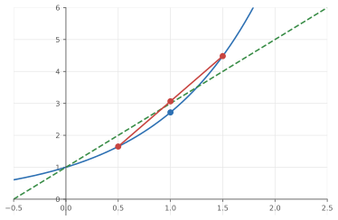

# EX04 — Jensen and Dithering
Back to [Index](../Index.md)

> [!question] Problem
> A cost is $f(x) = e^{x}$ at the operating point $x_0 = 1$. Dither: use $x_0 \pm 0.5$ with probability $\tfrac12$ each.
> (a) Compare $f(x_0)$ with $\E f(x_0 + z)$.
> (b) Repeat for the affine cost $g(x) = 2x + 1$.

## Solution
**(a)**
$$
\E f = \tfrac12\big(e^{0.5} + e^{1.5}\big) = \tfrac12(1.6487 + 4.4817) = 3.0652 \ >\ e^{1} = 2.7183
$$
Dithering raises the average cost by $0.347$: ✎ **dithering hurts**.

**(b)**
$$
\E g = \tfrac12\big(g(0.5) + g(1.5)\big) = \tfrac12(2 + 4) = 3 = g(1)
$$
For affine $g$, ✎ **the mean is the same if you dither**, matching your note $\tfrac{(x_0 + \Delta x) + (x_0 - \Delta x)}{2} = x_0$.

```python
import numpy as np
x0, d = 1.0, 0.5
print(0.5 * (np.exp(x0 + d) + np.exp(x0 - d)), np.exp(x0))  # 3.0652 2.7183
```

## Graph
The red chord midpoint $(1, 3.065)$ sits above $(1, e)$ on the curve. The gap is the Jensen gap.


## Takeaways
- The Jensen gap grows with the curvature $f''$ and with the noise variance. For small $z$, the gap is about $\tfrac12 f''(x_0)\Var z = \tfrac12 e \cdot 0.25 = 0.34$.
- It is the same inequality behind "averaging predictions reduces squared error" in [Bias-Variance Tradeoff](../ml-notebook/Bias-Variance%20Tradeoff.md).

## Related topics
- [Jensen's Inequality](../3-convex-functions/Jensen's%20Inequality.md)
