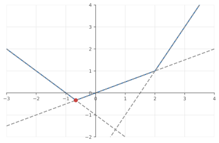

# EX05 — Pointwise Max of Affine Functions
Back to [Index](../Index.md)

> [!question] Problem
> Let $f(x) = \max\{-x - 1,\ 0.5x,\ 2x - 3\}$.
> (a) Why is $f$ convex?
> (b) Minimize $f$ by writing it as an LP.

## Solution
**(a)** Each piece is affine, so convex. A pointwise max of convex functions is convex: its epigraph is the intersection of the three halfspaces above the lines.

**(b)** Epigraph form:
$$
\begin{array}{ll}
\text{minimize} & t \\
\text{subject to} & -x - 1 \le t,\quad 0.5x \le t,\quad 2x - 3 \le t
\end{array}
$$
The breakpoints are where the pieces cross:
$$
-x - 1 = 0.5x \Rightarrow x = -\tfrac23, \qquad 0.5x = 2x - 3 \Rightarrow x = 2.
$$
The minimum is where the decreasing piece meets an increasing one:
$$
\boxed{\,x^\star = -\tfrac23,\quad p^\star = -\tfrac13\,}
$$

```python
import numpy as np
xs = np.linspace(-3, 4, 70001)
f = np.max(np.vstack([-xs - 1, 0.5 * xs, 2 * xs - 3]), axis=0)
print(xs[f.argmin()], f.min())  # -0.6667 -0.3333
```

## Graph


## Takeaways
- Every piecewise-linear convex function is a max of affine functions, and minimizing it is an LP.
- The optimum lands at a kink, where two constraints are active. That is a vertex of the LP.

## Related topics
- [Operations That Preserve Convexity of Functions](../3-convex-functions/Operations%20That%20Preserve%20Convexity%20of%20Functions.md)
- [Linear Programs](../4-convex-problems/Linear%20Programs.md)
